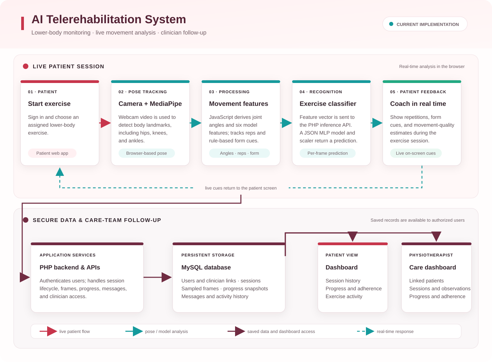

```{r setup, include=FALSE}
knitr::opts_chunk$set(echo = TRUE)
```

# Purpose and scope

This document summarizes the application architecture, implemented features,
recent user-interface and reliability work, test accounts, verification results,
and known limitations. The application is the existing capstone system, not a
separate demo. The current exercise scope is lower-body rehabilitation.

The application supports patients and physiotherapists. Camera-derived
measurements and movement cues are intended to support monitoring and discussion
with a physiotherapist; they are not a diagnosis and do not replace professional
care.

## Current exercise scope

- Squats
- Lunges
- Knee Extensions

Sit-to-Stand and Leg Raises were present in an earlier conceptual description,
but are not configured in the current exercise database or session controls.

# Implemented architecture

This diagram follows one live patient session from exercise selection through
movement analysis and feedback, then shows where saved records are used by the
patient and physiotherapist. The current classifier is a feed-forward
multilayer perceptron (MLP), not the LSTM sequence model in the original
proposal.

<div class="architecture-figure">
  
  <p class="figure-caption"><strong>Figure 1.</strong> Current lower-body telerehabilitation architecture and data flow.</p>
</div>

### How to read the diagram

1. **Start in the patient application.** The patient signs in and starts an
   assigned lower-body exercise.
2. **Capture and interpret movement in the browser.** The webcam supplies video
   to MediaPipe Pose. JavaScript processes the landmarks into joint angles,
   movement features, repetition states, and immediate form cues.
3. **Classify each movement sample.** A feature vector is sent to the PHP
   inference endpoint, which applies the JSON-exported MLP model and scaler.
   The result contributes to exercise recognition and feedback.
4. **Return coaching while saving the session.** Repetition counts and
   movement cues are shown to the patient. Authenticated PHP APIs save session
   summaries and sampled frames to MySQL.
5. **Use saved records for follow-up.** Patient pages show history and
   progress; the physiotherapist dashboard shows linked patients, session
   activity, adherence, observations, and progress.

**Color key:** red marks the patient-facing flow, teal marks movement
processing and recognition, and burgundy marks backend services, stored data,
and clinical follow-up. The lower data path represents persisted records, not
a second real-time camera stream.

## Technology and key components

| Area | Current implementation |
|---|---|
| User interface | HTML, CSS, browser JavaScript |
| Backend | PHP endpoints |
| Database | MySQL database named `rehabiai_db` in the local configuration |
| Authentication | PHP sessions and password hashes |
| Pose tracking | MediaPipe Pose in the browser using a webcam |
| Movement processing | JavaScript computes lower-body joint angles and a six-feature vector |
| Exercise recognition | PHP inference adapter applies a JSON-exported MLP classifier to a per-frame feature vector |
| Feedback | Local movement cues plus the PHP `ai_api.php?action=feedback` endpoint |
| Session persistence | `sessions` and sampled `session_frames` tables |
| Progress and communications | `progress_snapshots` and `messages` tables |
| Classifier tests | Python and NumPy integration test |

The six classifier features are left/right knee angle, left/right hip angle,
torso lean, and stance width. The external large dataset has not been imported
or used for fine-tuning. The Python training workflow currently uses the
configured CSV and supports synthetic data generation when its source data is
not available.

## Main application routes

| Route or endpoint | Purpose |
|---|---|
| `index.html` | Public landing page |
| `login.html`, `register.html` | Patient and physiotherapist authentication |
| `dashboard.html` | Patient overview and recent activity |
| `exercises.html` | Configured lower-body exercise library |
| `session.html` | Webcam session, pose tracking, reps, and feedback |
| `progress.html` | Patient progress and session history |
| `messages.html` | Patient-clinician messaging |
| `settings.html` | Profile and available preferences |
| `clinician.html` | Physiotherapist overview and patient list |
| `clinician-patients.html` | Searchable physiotherapist patient list |
| `clinician-patient.html` | Individual patient history and progress |
| `php/me.php` | Authenticated identity, profile, and preference API |
| `php/session_api.php` | Session lifecycle, movement frames, progress, and messages |
| `php/clinician_api.php` | Clinician patient list, details, and assignment endpoints |
| `php/exercises_api.php` | Authenticated exercise library |
| `php/infer_model.php` | Per-frame MLP exercise-classification endpoint |
| `php/ai_api.php` | Rules-based feedback and training-sample endpoint |

# Recent work

## Visual refinement

- Applied the burgundy, light neutral visual theme and responsive layouts.
- Refined the landing page, authentication, patient dashboard, progress,
  exercise, live-session, and physiotherapist screens.
- Updated lower-body exercise icons and page copy to match the supported scope.
- Kept the existing PHP APIs, MySQL data model, authentication, and routes.

## Reliability and usability fixes

- Added a unique clinician link code for new physiotherapist accounts and show
  the code on the clinician dashboard.
- Patient registration now reports an invalid clinician code rather than
  silently creating an unlinked patient.
- Clinician patient detail progress is limited to the latest 14 calendar days;
  the adherence value uses the latest 7 days.
- Corrected the role check that redirected physiotherapists away from the
  shared Settings page.
- Corrected responsive session layout rules after verifying card bounds at
  desktop, tablet, and mobile widths.
- Made the video and pose canvas overlays ignore pointer events so the camera
  activation button remains clickable.

# Local test accounts

These accounts were created in the local development database for workflow
verification. Their emails use the reserved `.example.test` domain and are not
real mailboxes.

| Role | Email | Password | Clinician code |
|---|---|---|---|
| Physiotherapist | `projectcap.audit.clinician.20261023@example.test` | `Audit-Physio-2026!` | `DR-474A5D` |
| Patient | `projectcap.audit.patient.20261023@example.test` | `Audit-Patient-2026!` | Linked to `DR-474A5D` |

**Local testing only:** these are credentials, not production secrets. Do not
reuse them in a deployed environment, publish them, or use real patient
information with this test setup. Change or remove the local test accounts
before sharing the database or deploying the application. This document has
been created locally and has not been committed.

# Verification performed

The two local test accounts were used to exercise the patient and
physiotherapist workflows in the browser.

| Area | Result | Evidence / notes |
|---|---|---|
| Patient registration and login | Passed | Patient linked to the test physiotherapist using the clinician code |
| Physiotherapist registration and login | Passed | A unique clinician code was shown on the dashboard |
| Patient dashboard | Passed | Dashboard, exercise cards, recent session table, and patient identity loaded |
| Exercise library | Passed | Squats, Lunges, and Knee Extensions loaded |
| Progress view | Passed | Chart, summary cards, and session history rendered |
| Patient settings | Passed | Profile phone field and real-time feedback preference persisted; the test patient's phone and preference were restored afterward |
| Clinician patient list | Passed | Patient appeared; search and adherence filtering were exercised |
| Clinician patient details | Passed | Patient, sessions, and progress were displayed |
| Clinician settings | Passed | Shared Settings page remained accessible after the role-guard fix |
| Two-way messaging | Passed | Patient and clinician each sent a test message and could read the conversation |
| Model integration | Passed | Python integration test classified representative squat, lunge, and knee-extension samples |
| Inference endpoint | Passed | Authenticated request returned HTTP 200 and an exercise prediction |
| Feedback endpoint | Passed | Authenticated request returned HTTP 200 and feedback text |
| Live camera and pose tracking | Passed | Browser camera connected; MediaPipe detected landmarks and updated joint angles, form estimates, and feedback |
| Movement-based repetition counting | Passed | A live squat test advanced the counter to 15 and then into set 2 |
| Session save and patient history | Passed | A paused test session was saved and appeared in patient history |
| Clinician access to saved session | Passed | Physiotherapist dashboard and patient record showed the new session |
| Session layout | Passed | Checked at 1280x800, 850x613, and 390x844; no session-card overlaps or horizontal document overflow were detected |
| JavaScript lint | Passed | `npm run lint` |
| PHP syntax | Passed | All PHP files passed `php -l` |
| Python classifier integration | Passed | `python python\integration_test.py` |
| Patch formatting | Passed | `git diff --check` |

## Live session test records

The test patient currently has these locally recorded squat sessions from
camera workflow verification:

| Recorded reps | Completed sets | Status | Notes |
|---:|---:|---|---|
| 0 | 0 | Partial | Earlier camera/session lifecycle test |
| 10 | 0 | Partial | First movement-based counter check |
| 17 | 1 | Partial | Counter reached 15, advanced to set 2, then the session was paused and saved |

The latest 17-rep record is visible to both the patient and physiotherapist.
It is correctly marked partial because the configured squat target is three
sets of 15. No additional sets were requested just to create a completed test
record.

The conversation contains two local workflow-test messages:

- `Functional audit check — please ignore.`
- `Clinician reply test — received.`

These are test artifacts, not clinical communication.

# Known limitations and unverified behavior

- **Full completed workout:** the completion state after all three squat sets
  has not been verified. Repetition counting, set advancement, and partial
  session saving have been verified.
- **Recognition accuracy:** one live classification check reported `lunge`
  while Squats was selected. A single check does not establish model accuracy;
  representative integration samples passed, but robust real-world validation
  remains necessary.
- **Form/quality scoring:** the browser displayed low quality estimates during
  the test. These heuristic estimates have not been clinically validated and
  should not be interpreted as medical assessment.
- **Password reset:** email delivery is not configured; the current page
  instructs users to contact an administrator.
- **Session reminders and dark mode:** these are marked as coming soon and are
  disabled in Settings.
- **External dataset fine-tuning:** not performed. Dataset schema, labels,
  licensing, and validation need review before use.
- **Exhaustive testing:** the checks above cover important workflows, not every
  error condition, browser, device, database migration path, or security case.

# Running locally

1. Install XAMPP or another PHP and MySQL environment.
2. Place the repository under the web-server document root, such as
   `C:\xampp\htdocs\project_cap`.
3. Import `schema.sql` into MySQL.
4. Start Apache and MySQL.
5. Open `http://localhost/project_cap/` in a supported browser. Do not use
   `file://`; PHP API requests need a web server.
6. Sign in using the local test accounts above and allow camera access for live
   sessions.

The database connection settings are kept in `php/config.php`. Review and
replace local development settings before deploying.

# Useful validation commands

Run from the repository root:

```powershell
npm run lint
python python\integration_test.py
git diff --check
```

To check PHP syntax with XAMPP:

```powershell
$files = Get-ChildItem php -Filter *.php -Recurse
foreach ($file in $files) {
  C:\xampp\php\php.exe -l $file.FullName
}
```

# Related project files

- [Architecture diagram](architecture.svg)
- [Project README](README.md)
- [Python model notes](python/README.md)
- [Database schema and seed data](schema.sql)
- [Live session interface](session.html)
- [Live session logic](js/session.js)
- [Session API](php/session_api.php)
- [Clinician API](php/clinician_api.php)
- [Patient and clinician authentication](php/register.php)
